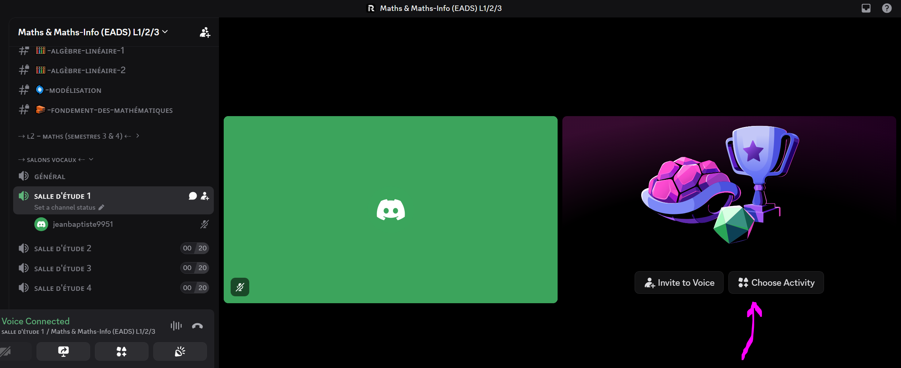
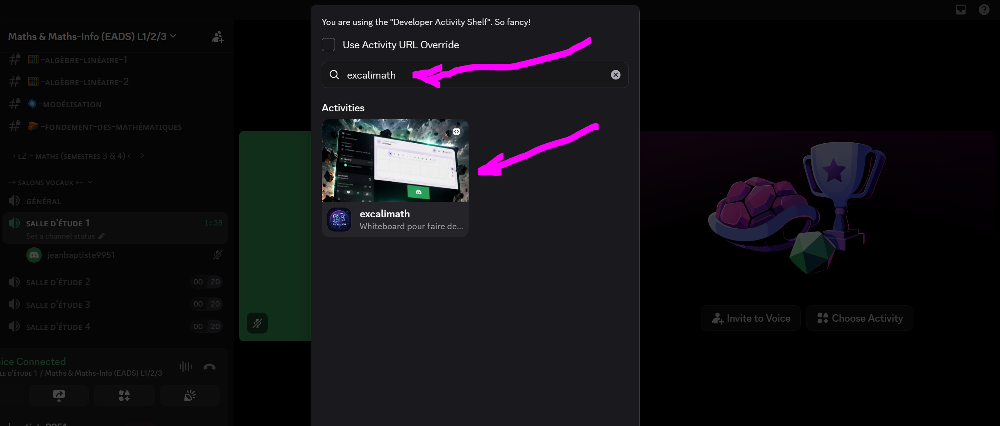
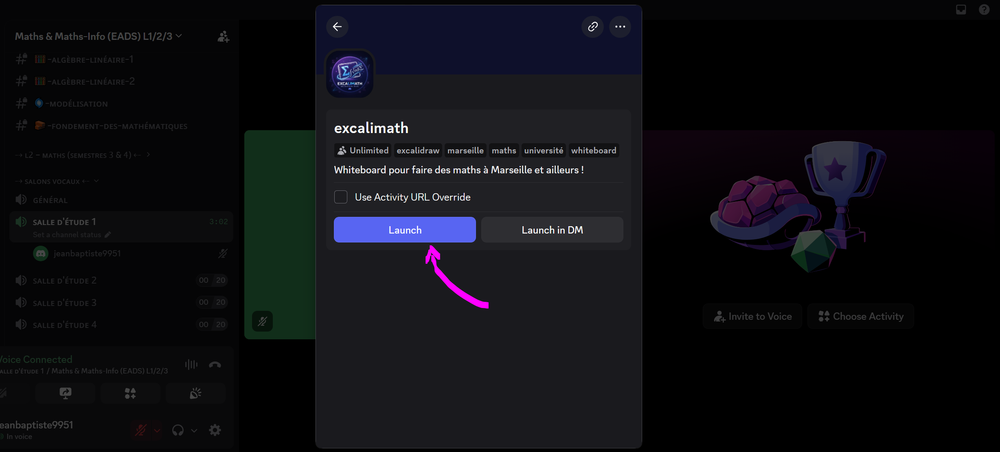
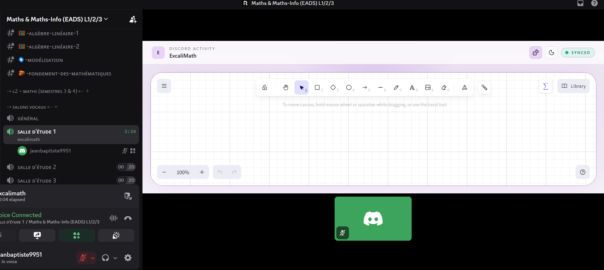

  

  <strong>Les mathématiques prennent une autre dimension quand on les cherche ensemble.</strong>

  <a href="https://github.com/1718-io/discord-excalimath">Code source</a>
  ·
  <a href="https://discord-excalimath.pages.dev/terms">Conditions d'utilisation</a>
  ·
  <a href="https://discord-excalimath.pages.dev/privacy">Confidentialité</a>

---

## Un tableau. Plusieurs esprits. Des mathématiques.

Vous bloquez sur un exercice d'algèbre linéaire ?
Vous souhaitez comprendre une démonstration, préparer une khôlle
ou simplement réfléchir avec d'autres étudiants ?

**Retrouvez vos camarades autour d'un même tableau blanc, directement dans Discord.**

Avec ExcaliMath, chacun peut contribuer au tableau et voir les
contributions des autres en temps réel.

L'objectif : multiplier les occasions de chercher, de raisonner,
de confronter des méthodes et de progresser ensemble.

---

## ✍️ Les mathématiques, en direct et à plusieurs

Avec ExcaliMath, chaque participant peut travailler sur le même tableau. Les écritures et les constructions des autres deviennent visibles en temps réel.

- **Construisez vos raisonnements ensemble.** Posez les hypothèses, développez les calculs et faites apparaître les étapes d'une démonstration.
- **Confrontez vos méthodes.** Comparez plusieurs approches d'un même problème et discutez de leurs avantages.
- **Expliquez ce que vous comprenez.** Aidez un camarade à franchir une difficulté en détaillant votre raisonnement.
- **Apprenez de vos erreurs.** Repérez une étape incorrecte, questionnez une hypothèse et reprenez la démonstration.
- **Travaillez à distance.** Retrouvez vos camarades autour d'un tableau commun, même lorsque vous ne pouvez pas vous retrouver physiquement.

> En mathématiques, une réponse correcte ne suffit pas toujours : comprendre pourquoi elle est correcte fait toute la différence.

## 🎓 Un outil pour les étudiants de L1, L2 et L3

Que vous suiviez vos cours sur le campus ou à distance, ExcaliMath peut accompagner vos séances de travail.

### 🤝 Résoudre un exercice ensemble

Un exercice vous résiste ? Invitez quelques camarades, exposez vos idées et cherchez une solution justifiée, étape après étape.

### 🗣️ S'entraîner aux khôlles

Organisez des interrogations orales entre étudiants. Présentez un raisonnement, répondez aux questions et entraînez-vous à défendre chaque étape de votre démonstration.

### 📚 Réviser les cours et les démonstrations

Reprenez ensemble les notions qui demandent de la pratique : algèbre linéaire, analyse, suites, fonctions, matrices, espaces vectoriels ou raisonnement logique.

### 🏠 Rompre l'isolement des études à distance

On peut suivre un cours à distance sans vouloir travailler seul. ExcaliMath offre un support commun pour organiser des séances de travail et retrouver une dynamique collective.

### 💡 Apprendre en transmettant

Expliquer une notion oblige à clarifier ses idées, à justifier ses étapes et à identifier ce que l'on n'a pas encore complètement compris.

**Aider quelqu'un à comprendre les mathématiques, c'est aussi approfondir sa propre compréhension.**

---

## 🧠 Faire vivre une véritable communauté mathématique

Une communauté universitaire ne se résume pas à partager des documents ou à poser des questions. Elle peut aussi devenir un espace où les étudiants réfléchissent ensemble, échangent des méthodes et construisent progressivement leur maîtrise des mathématiques.

Une difficulté individuelle peut devenir une recherche collective.

Une intuition peut être confrontée à une démonstration rigoureuse.

Deux solutions différentes peuvent révéler deux façons de comprendre un même résultat.

L'objectif n'est pas de remplacer le travail personnel, les cours ou les enseignements de l'université. Il est de **créer davantage d'occasions de pratiquer les mathématiques, de discuter des raisonnements et de progresser ensemble**.

Que vous soyez en L1, en L2 ou en L3 à Aix-Marseille Université, que vous aimiez résoudre des problèmes ou que vous cherchiez encore vos méthodes de travail, vous pouvez participer à cette dynamique.

---

## 🚀 Comment commencer ?

**Pas besoin d'organiser une grande séance pour essayer. Un seul exercice et deux camarades suffisent.**

1. Rejoignez un salon vocal du serveur Discord.
2. Lancez l'activité ExcaliMath depuis le lanceur d'activités Discord:

3. Cliquez sur "Launch" pour lancer dans le canal audio:

4. Et boum, vous voilà avec un tableau sur lequel vous pouvez travailler avec ceux qui vosu rejoignent dans votre salon vocal:

5. Invitez les participants à rejoindre le tableau partagé.
6. Choisissez un exercice, une question de cours ou une démonstration.
7. Commencez à chercher ensemble !

Vous pouvez également proposer une séance de révision, une khôlle entre étudiants ou un rendez-vous régulier autour des mathématiques.

### Votre prochain exercice mérite peut-être un tableau commun.

**Lancez ExcaliMath, invitez quelques camarades et voyez ce que vous pouvez construire ensemble.**

---

## 🔓 Un projet open source

ExcaliMath est un projet open source reposant sur Excalidraw et son extension ExcaliMath.

Son code est publiquement accessible : chacun peut découvrir son fonctionnement, examiner son implémentation et contribuer à son amélioration.

**Vous souhaitez participer au projet ?**

- 🔍 **Explorer le code** pour comprendre l'architecture de l'application.
- 🐛 **Signaler un problème** en décrivant les étapes permettant de le reproduire.
- 💡 **Proposer une fonctionnalité** qui pourrait améliorer le travail mathématique collaboratif.
- 🛠️ **Contribuer au développement** en proposant des modifications du code.
- 🧪 **Participer aux tests** et partager vos retours d'utilisation.

La contribution ne se limite pas à la programmation : des retours pédagogiques précis, des suggestions pertinentes et des signalements de bugs sont également précieux.

  <a href="https://github.com/1718-io/discord-excalimath"><strong>→ Découvrir le code source sur GitHub</strong></a>

---

## 🔐 Transparence et confidentialité

Avant d'utiliser ExcaliMath, vous pouvez consulter les documents qui encadrent son utilisation :

- [Conditions générales d'utilisation](https://discord-excalimath.pages.dev/terms)
- [Politique de confidentialité](https://discord-excalimath.pages.dev/privacy)

Pour vérifier le statut officiel de l'application sur Discord, consultez sa fiche dans Discord et, pour une confirmation définitive, le statut indiqué dans le Discord Developer Portal. Le fait qu'une application soit autorisée sur un serveur ne signifie pas nécessairement qu'elle a été officiellement vérifiée par Discord.

---

  <strong>Les mathématiques ne se résument pas à trouver le résultat.</strong>
   
  Elles consistent aussi à chercher, comprendre, démontrer et transmettre.

  <strong>∎ À vous de jouer.</strong>

