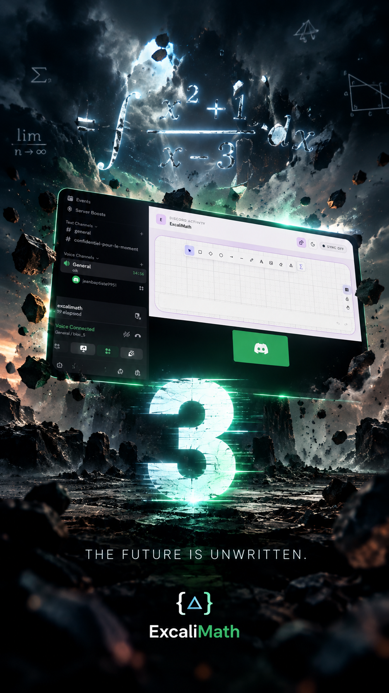

<p align="center">
  
</p>

<p align="center">
  <strong>Les mathématiques prennent une autre dimension quand on les cherche ensemble.</strong>
</p>

<p align="center">
  <a href="https://github.com/1718-io/discord-excalimath">Code source</a>
  ·
  <a href="https://discord-excalimath.pages.dev/terms">Conditions d'utilisation</a>
  ·
  <a href="https://discord-excalimath.pages.dev/privacy">Confidentialité</a>
</p>

---

## Un tableau. Plusieurs esprits. Des mathématiques.

Vous bloquez sur un exercice d'algèbre linéaire ?
Vous souhaitez comprendre une démonstration, préparer une khôlle
ou simplement réfléchir avec d'autres étudiants ?

**Retrouvez vos camarades autour d'un même tableau blanc, directement dans Discord.**

Avec ExcaliMath, chacun peut contribuer au tableau et voir les
contributions des autres en temps réel.

L'objectif : multiplier les occasions de chercher, de raisonner,
de confronter des méthodes et de progresser ensemble.

---
<!-- INCLUDE: ./BANNER.md -->



## Try it locally

* Start backend:

```bash
cd backend
export HOST=127.0.0.1
export PORT=6998
pnpm dev
```

* Start front end:

```bash
cd frontend
export VITE_DISCORD_CLIENT_ID=****************
export VITE_ROOM_SERVER_URL=ws://127.0.0.1:6998
pnpm dev
```

now you will see the connection happening in the room in the server logs, and when you will draw on the board, you will see more server log lines like:

```bash
[rooms] board update local-development revision <a number here>
```
