# Discord integration

To use this application from within discord, e.g. inside an audio channel:

* This application must be deployed and reachable by discord services
* You must configure a discord activity.

### Step 1: Create a discord application

This will give you a _"CLIENT ID"_ and a _"PUBLIC KEY"_, basicallly its an OAuth App, keep both, t for iscord integration you will only need the _"CLIENT ID"_.

That _"CLIENT ID"_ value will be the value that you will set for the `VITE_DISCORD_CLIENT_ID` frontend env. variable.

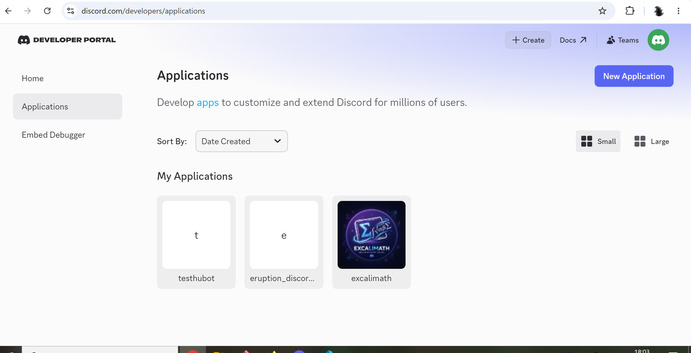

### Step 2: Enable the app

You must then "enable" the app which is doisabled by default:

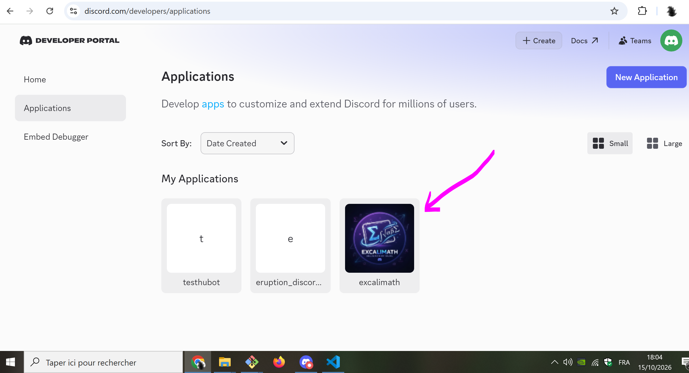

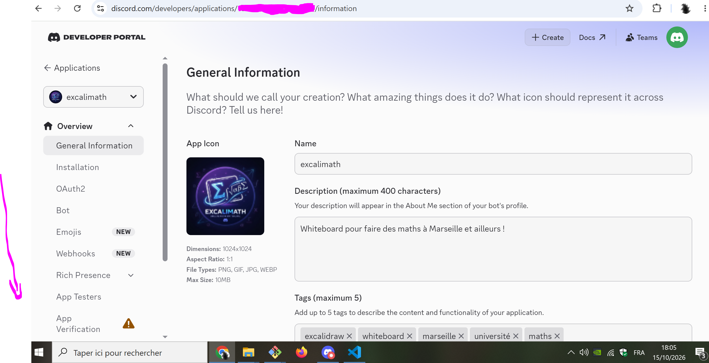

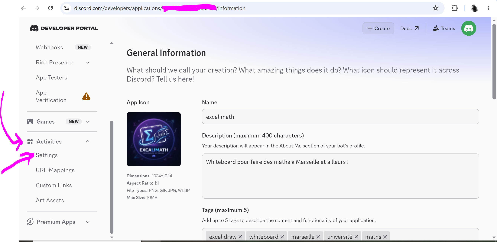

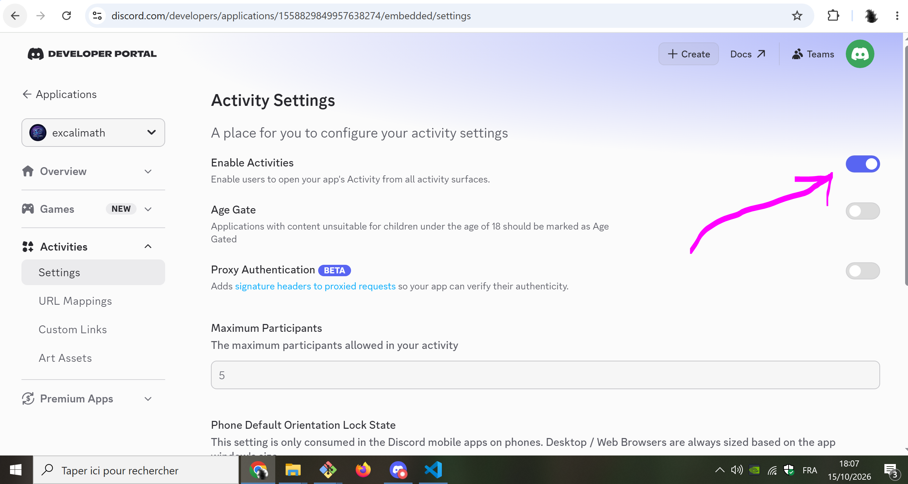

### Step 3: Set the URL mapping

You must set the URL mapping to the URL of your deployed service:

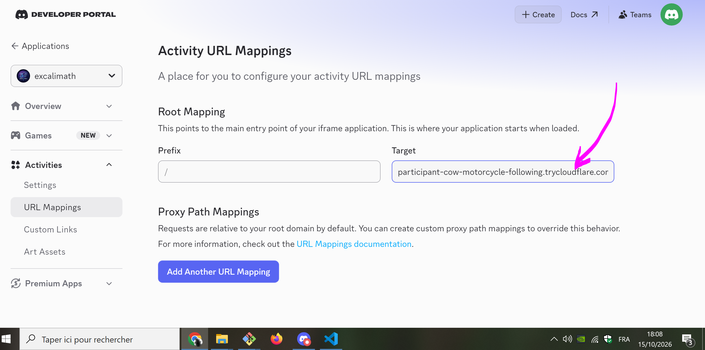

### Step 4: Set who can install the app, and get the installation link

Set who can install the app, and get the installation link:

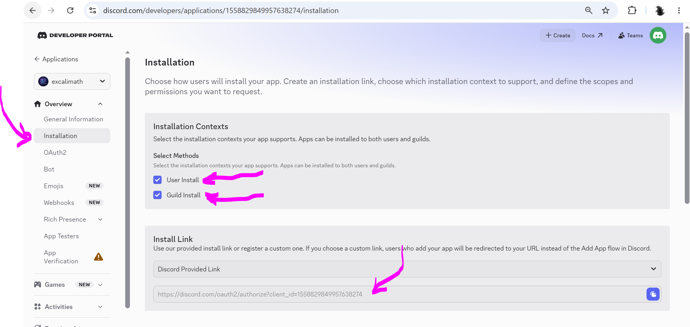

When you send the link to a channel or to a DM, here is what people will see:

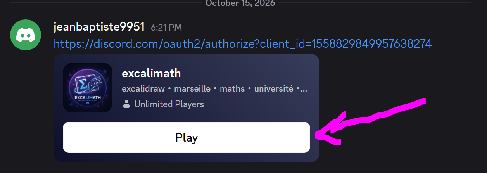

If any user clicks on the "Play" button, this will start the app inside Discord.

If the link is in a channem of a server, and the user clicking it is an admin, the app will then be available among available activities during audio channels:

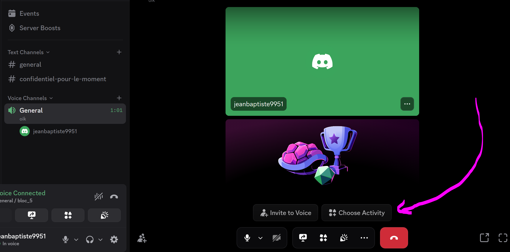

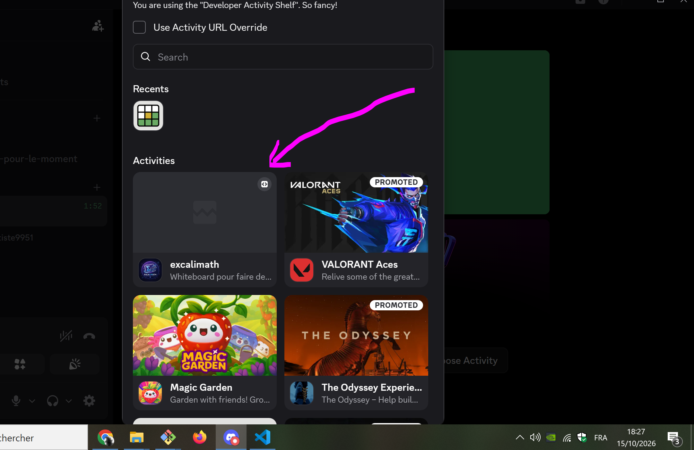

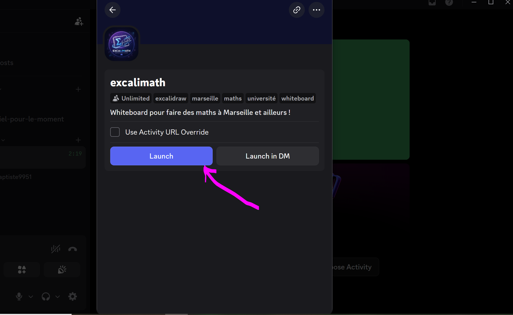

### Bonus: Dev mode

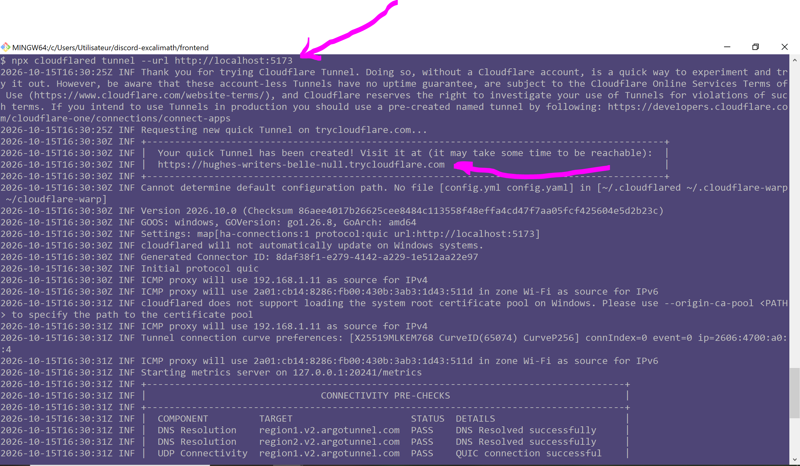

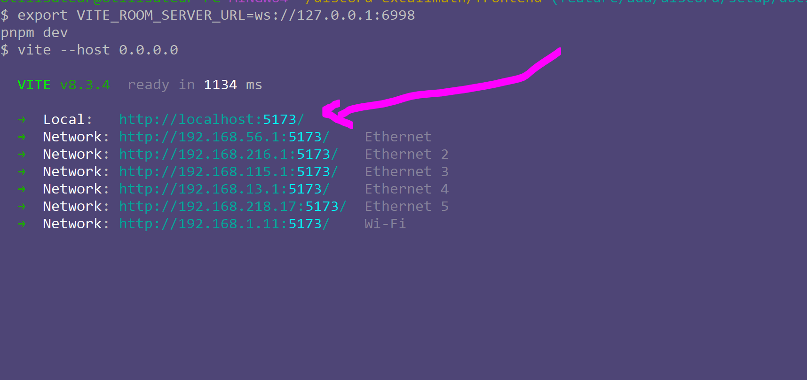

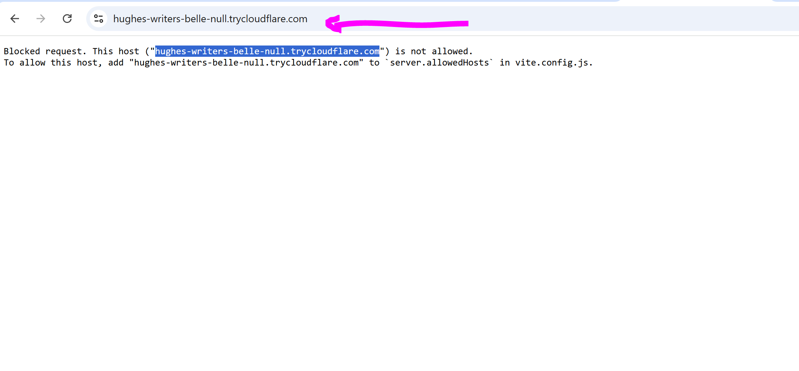

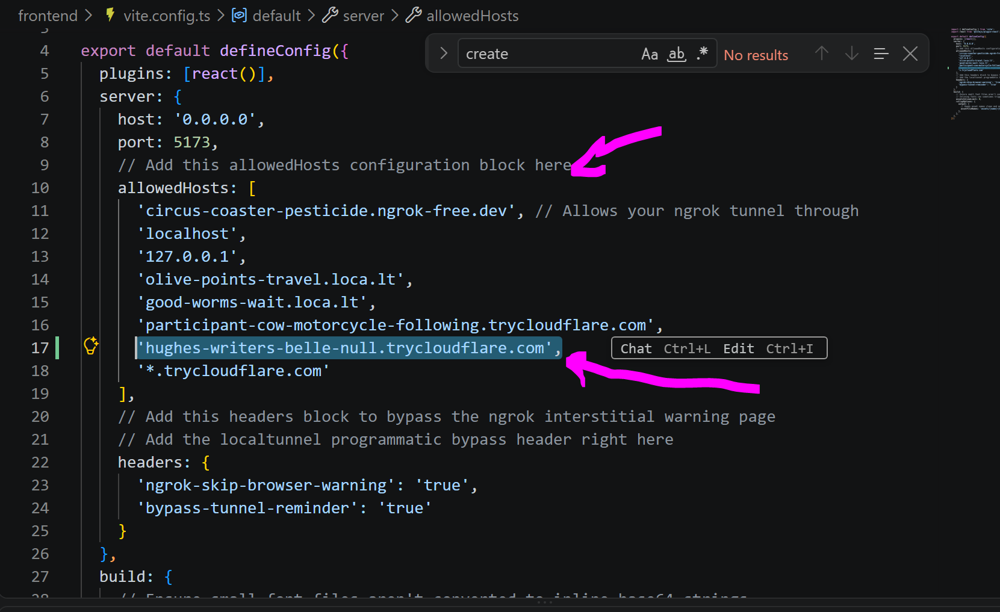

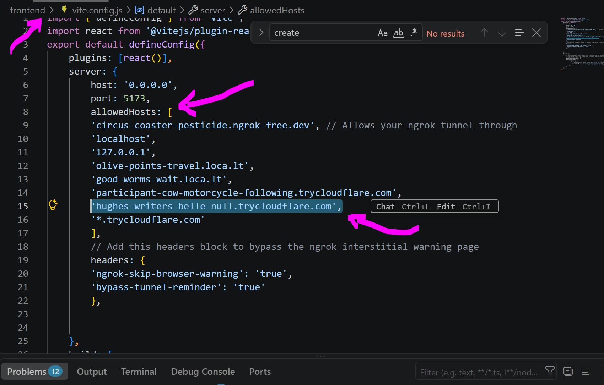

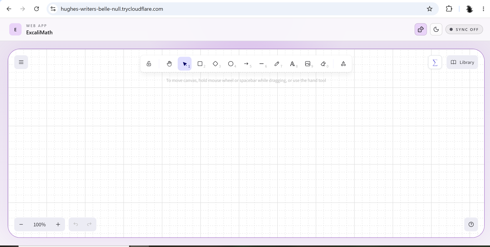

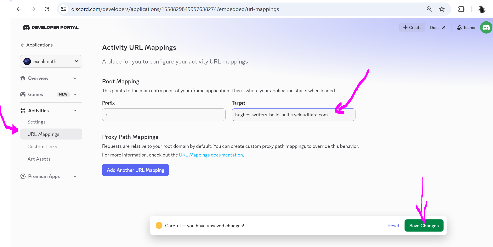

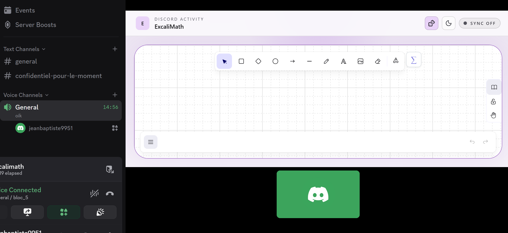

## ANNEX Step Allowed Origins — Allow your WebSocket server in Discord's configuration

You need to authorize excali-math-backend.onrender.com in the configuration for your Discord Activity.
1. Open the Discord Developer Portal.
2. Select your ExcaliMath application.
3. Find the Activities section in the application's settings.
4. Look for the URL-mapping, allowed-origin, or networking configuration for the Activity.